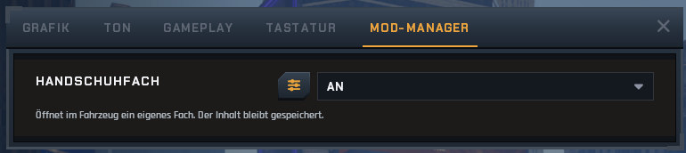
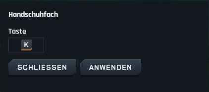

  

  <a href="#the-compartment">The compartment</a>
  &nbsp;·&nbsp;
  <a href="#mod-manager">Mod Manager</a>
  &nbsp;·&nbsp;
  <a href="#key">Key</a>
  &nbsp;·&nbsp;
  <a href="#the-loader">The loader</a>
  &nbsp;·&nbsp;
  <a href="#install">Install</a>
  &nbsp;·&nbsp;
  <a href="#save">Save</a>
  &nbsp;·&nbsp;
  <a href="#game-047">Game 0.4.7</a>
  &nbsp;·&nbsp;
  <a href="#author">Author</a>

  A PineLoader mod for Pionero Capital. 
  In a vehicle it opens a glovebox, separate from the trunk. 
  The contents stay saved.

  
  
  

  

The loader is [PineLoader 1.0.1](https://github.com/EuroCent82/PineLoader/releases/latest). The same guide is on [PineLoader.dev](https://pineloader.dev) and [PineLoader.de](https://pineloader.de). This repository holds the Glovebox release. The pictures below are the German game. The labels follow the language of the game.

## The compartment

K opens the glovebox from any seat. The upper row is the compartment. The lower row is the inventory you are carrying. The two are separate, and the glovebox is not the trunk.

  

## Mod Manager

The row is named in the game's language. In German it reads Handschuhfach. An turns it on, Aus turns it off. Turning it off leaves the saved items where they are.

  

## Key

The gear on that row opens the key page. The key is captured the same way as on the keyboard tab. The default is K. Close and Apply use the game's own words.

  

## The loader

PineLoader lists the mod before the game starts. In this window both mods were found and both were loaded. Start game here, or press Play in Steam.

  

## Install

Install PineLoader first, then Glovebox. The same steps are in [instructions.txt](instructions.txt).

### PineLoader

1. Download [PineLoader 1.0.1](https://github.com/EuroCent82/PineLoader/releases/latest). The file is `PineLoader-1.0.1-win-x64.zip`.
2. Unpack it into a folder named `PineLoader` next to the game, so the program is `Pionero Capital\PineLoader\PineLoader.exe`.
3. Close the game and start `PineLoader.exe` once. The loader saves the official file as `PioneroCapital-Win64-Game.exe` and points `PioneroCapital-Win64-Shipping.exe` at itself.
4. Leave the Steam launch options empty. **Play** in Steam starts PineLoader first.

### Glovebox

1. Download [Glovebox 1.0.0](https://github.com/EuroCent82/Glovebox/releases/latest). The file is `Glovebox-1.0.0.zip`.
2. Copy the `Glovebox` folder from that zip into `PineLoader\Mods`. The two files are `Glovebox.dll` and `glovebox-agent.jar`.
3. Start the game through PineLoader. The loader writes `Config\Glovebox.ini` when that file is missing.

The default key is K, from any seat.

## Save

Saved items are in `PineLoader\Cache\glovebox.json`. Leave that file in place if you want to keep them. Each vehicle keeps its own number of slots.

## Game 0.4.7

Pionero Capital 0.4.7, Steam build 26637959, renamed the server classes this build calls. On that build the glovebox does not open yet.

## Author

EuroCent82. The site is [PineLoader.dev](https://pineloader.dev) and [PineLoader.de](https://pineloader.de). PineLoader is [release 1.0.1](https://github.com/EuroCent82/PineLoader/releases/latest). Glovebox is [release 1.0.0](https://github.com/EuroCent82/Glovebox/releases/latest).

## License

Apache License 2.0. The full text is in [LICENSE](LICENSE).

The Nexus Mods header is [screenshot/banner-nexusmods.png](screenshot/banner-nexusmods.png), 1300 by 372.
